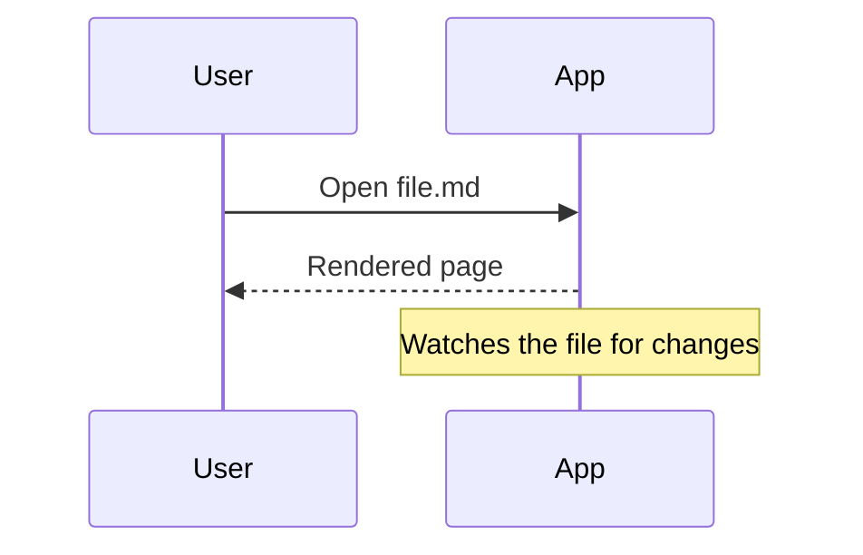
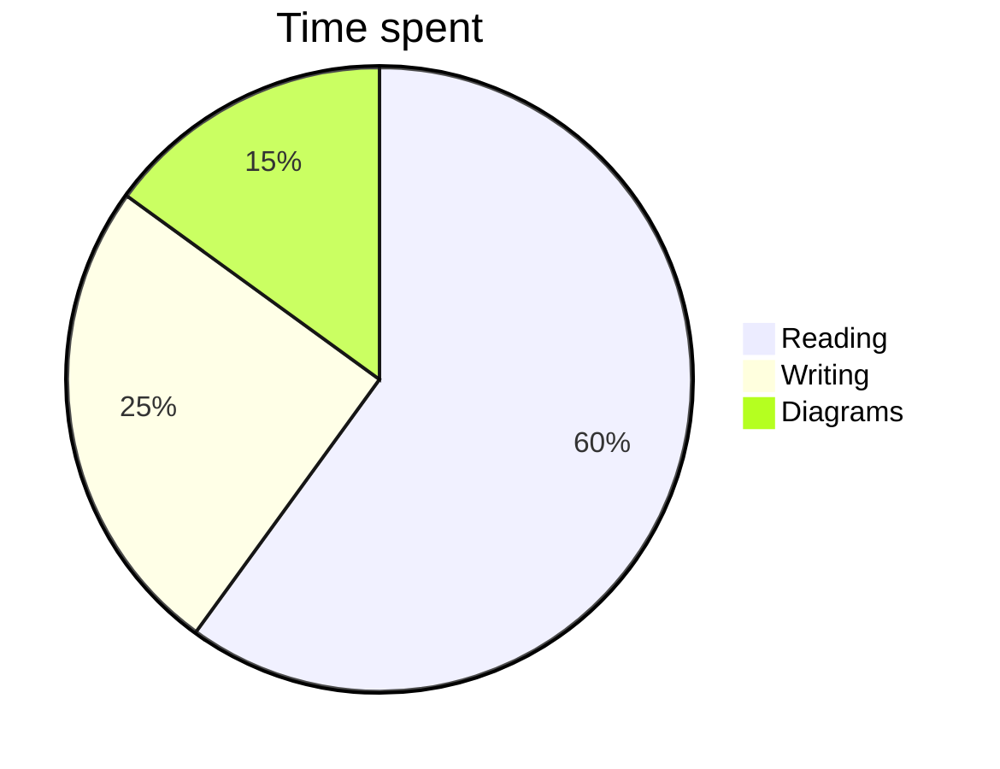

# MD Reader feature test

Inline math $e^{i\pi} + 1 = 0$, bracket style \(\alpha^2 + \beta^2\), and prices like $5 and $10 should stay plain text.

\[
\int_0^\infty e^{-x^2}\,dx = \frac{\sqrt{\pi}}{2}
\]

```math
\mathbf{A} = \begin{pmatrix} a & b \\ c & d \end{pmatrix}, \quad \det \mathbf{A} = ad - bc
```

## Code

```swift
struct Greeter {
    let name: String
    func greet() -> String { "Xin chào, \(name)!" }
}
```

Inline `code` and a footnote[^1].

## Lists

- [x] Render tables
- [ ] Conquer the world

| Left | Center | Right |
| :--- | :----: | ----: |
| a | b | 1.00 |
| **bold** | `code` | $x^2$ |

## Sequence



## Pie



## Broken diagram (should show an error box)

```mermaid
flowchart LR
    A --> 
```

## Tiếng Việt heading

[Link to the heading above](#sequence) · [external](https://example.com)

[^1]: This is the footnote text.
