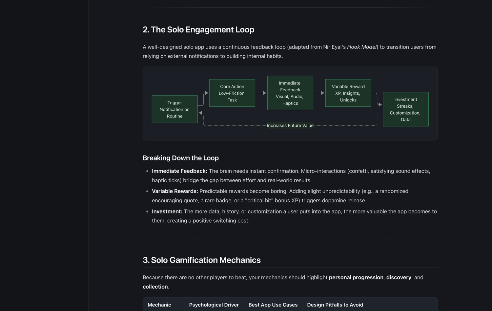

# MD Reader

A small, dark-themed macOS reader for Markdown files, with:

- **LaTeX**: `$…$`, `$$…$$`, `\(…\)`, `\[…\]` and ```` ```math ```` blocks (KaTeX)
- **Mermaid**: every diagram type; click a diagram to view it full-window, Esc to close
- **GFM tables**, task lists, footnotes, syntax-highlighted code with a Copy button
- **Outline sidebar** that tracks your position (⌃⌘S to show/hide)
- **Distraction-free**: the title bar is hidden and shows only while the mouse is at the top edge
- **Live reload**: the page updates when the file changes on disk and keeps your scroll position
- Relative images and links work; links to other `.md` files open in MD Reader

Everything is bundled, so it works offline.




## Android

The same viewer also runs as an Android app (`android/`): one WebView with the bundled
`Web/` folder, so math, diagrams, tables and the dark-green theme are identical.

- Open a `.md` from your file manager (Open with → MD Reader), share a file or text to it,
  or tap the folder button to pick a file; the last picked file reopens next time.
- The ☰ and folder buttons stay hidden while reading: at the top of the page, a long pull
  slides the page down to reveal them (with a haptic tick). ☰ shows the outline as a drawer; Back closes
  it (or a zoomed diagram) before leaving.
- On Xiaomi/HyperOS it uses the phone's MiSans font with tuned weights.

```bash
android/build.sh              # builds android/build/MDReader.apk and installs it via adb
android/build.sh --no-install
```

Needs the Android SDK (build-tools 35, platform 35), JDK 17 and adb; no Gradle.

## Shortcuts

| Key | Action |
| --- | --- |
| ⌘O | Open |
| ⌘= / ⌘- / ⌘0 | Zoom in / out / reset (remembered) |
| ⌃⌘S | Outline sidebar |
| ⌘R | Reload |
| ⌘E | Open in the default editor |
| ⇧⌘R | Show in Finder |
| ⌘P | Print (uses a light, ink-friendly style) |

## Build

```bash
./build.sh              # builds and installs /Applications/MD Reader.app
./build.sh --no-install
```

Needs only the Command Line Tools (no Xcode). It is set as the default app for `.md`
(to set it again on another Mac:
Finder → select any .md → Get Info → Open with: MD Reader → Change All…).

⌘E opens the file in your editor; choose which one with
`defaults write com.binhphuong-ab.mdreader editorBundleID <bundle id>`.

## Layout of the code

- `Sources/MDReader/`: AppKit app (no SwiftUI). `MarkdownDocument` is a read-only
  NSDocument that polls the file for changes, `ViewerWindowController` owns the
  WKWebView, toolbar and zoom, `ChromeAutoHider` fades the title bar, and `SchemeHandler` serves `mdr://app/…` (the
  viewer) and `mdr://file/…` (local images) to the web view.
- `Web/`: `viewer.html/css/js` does the rendering with markdown-it + KaTeX +
  Mermaid + highlight.js. `Web/vendor/` holds pinned copies of those libraries;
  run `tools/vendor.sh` to upgrade them.
- `android/`: `MainActivity.java` (WebView host, file intents, picker), manifest, and a
  Gradle-free `build.sh`; `tools/make-android-icon.swift` draws the adaptive icon.
- `Examples/feature-test.md`: one file that exercises every feature.

## License

MIT, see [LICENSE](LICENSE). The bundled libraries in `Web/vendor` keep their own licenses
(all MIT, except highlight.js: BSD-3-Clause, and markdown-it-task-lists: ISC).
